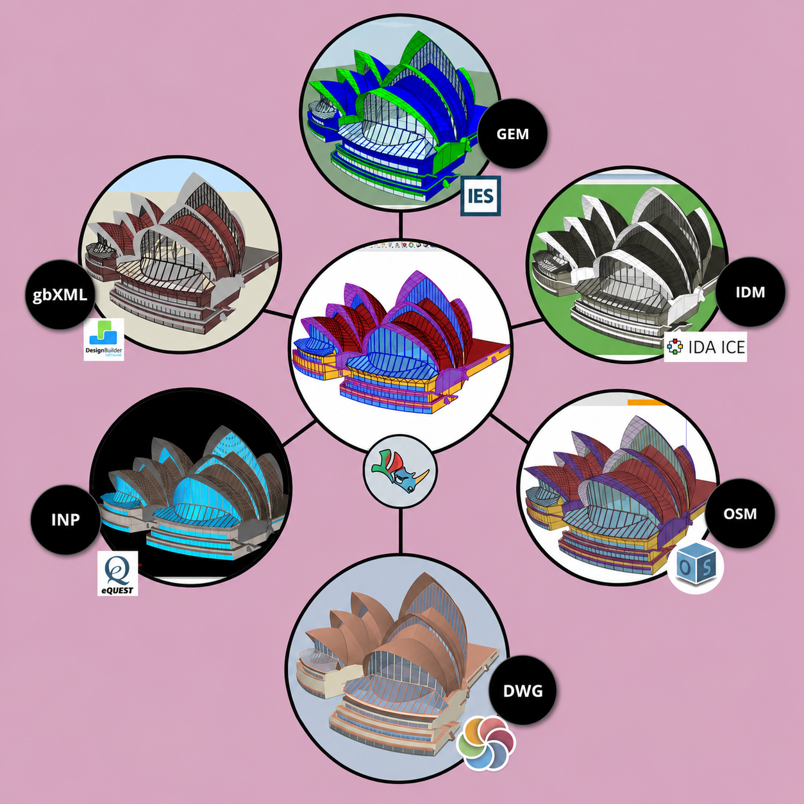

[中文](README.md) | English

# honeybee-gbas

<p>
  
  
</p>

`honeybee-gbas` is a **Honeybee** extension (`1.0.0`) that exports **Honeybee** models to native **GBAS2026** DWG drawings directly in pure Python.

Export coverage includes model geometry, room boundaries, window and door openings, roof skylights, shades, and source thermal properties.

## Sydney Opera House Showcase

<p>
  
</p>

The figure above showcases the Sydney Opera House model across building simulation formats, with the bottom branch showing the native DWG produced by `honeybee-gbas`.

## Requirements

- Python 3.9 or higher.
- Core packages: `honeybee-core`, `honeybee-energy`, `honeybee-energy-standards`, `ladybug-geometry`, and `shapely` 2.x.
- Project setup, weather configuration, and building performance simulation run inside the **GBAS2026** runtime.

## Installation and Uninstallation

Installing resolves all Python dependencies automatically, and uninstalling removes the package cleanly.

```console
python -m pip install .
python -m pip uninstall honeybee-gbas
```

## Quick Start

### Python API

```python
from honeybee.model import Model
from honeybee_gbas.writer import model_to_dwg

model = Model.from_file("model.hbjson")
dwg_path, report = model_to_dwg(
    model,
    "model.dwg",
    report_path="model.report.json",
    overwrite=True,
)
```

`model_to_dwg` is the single public export function and is also registered on `model.to.dwg`.

It accepts a **Honeybee** `Model` and returns `(Path, dict)`, writes a JSON export report when `report_path` is provided, and replaces existing files when `overwrite=True`.

Before exporting, `model.check_for_extension("gbas")` and `model.properties.gbas` validate room presence and horizontal floor boundaries.

### Command Line Interface

```console
honeybee-gbas --help
honeybee-gbas translate model-to-dwg model.hbjson -o model.dwg --report model.report.json --overwrite
python -m honeybee_gbas translate model-to-dwg model.hbjson -o model.dwg
```

By default, the CLI writes to the input filename stem with a `.dwg` extension; pass `--report` and `--overwrite` to write a JSON report and replace existing files.

## Sample Models

The `samples` directory organizes 12 test models into per-case subdirectories.

Each subdirectory contains `<case>.hbjson`, the exported `<case>.dwg`, and a standalone `<case>.html` 3D preview.

## License

This project is licensed under AGPL-3.0-only, and derived DWG binary backend modules from ezdwg retain the MIT license.

Full license texts are provided in `LICENSE` and `honeybee_gbas/dwg/LICENSE-ezdwg.txt`.
