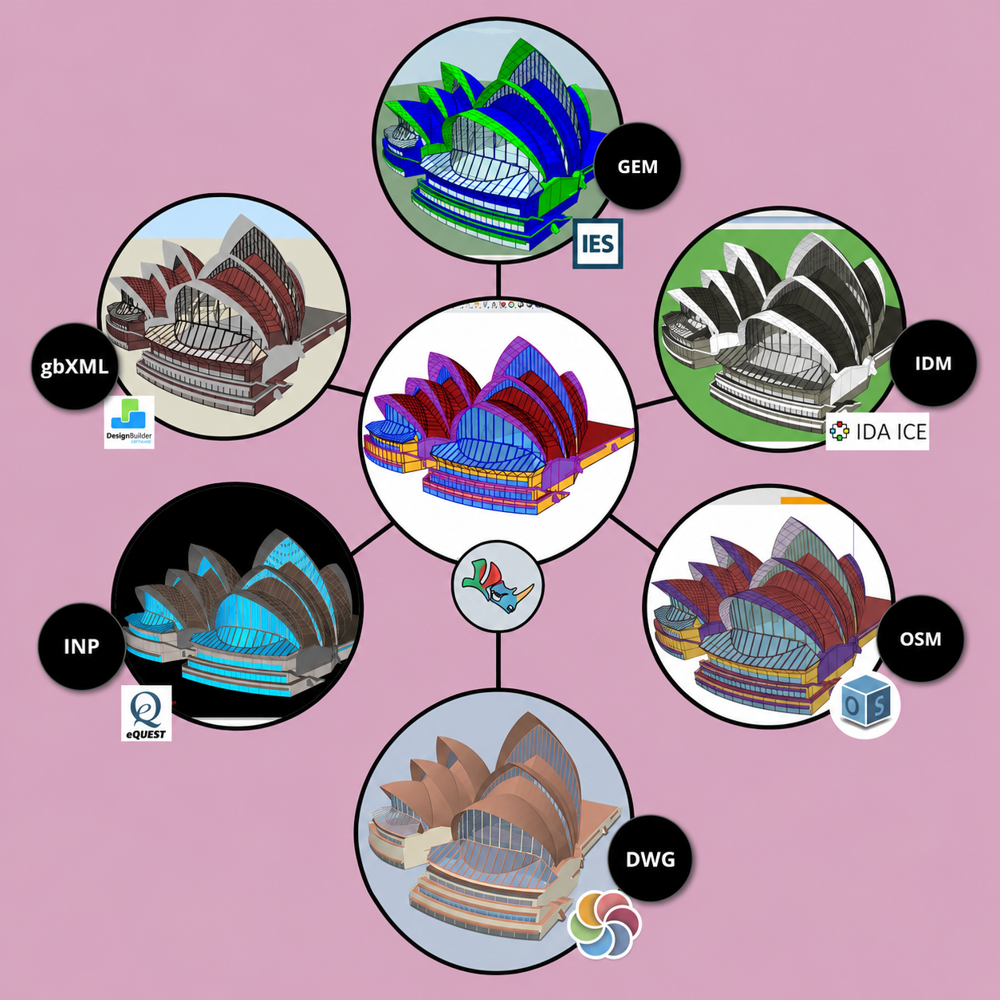

中文 | [English](README.en.md)

# honeybee-gbas

<p>
  
  
</p>

`honeybee-gbas` 是面向 **GBAS2026** 的 **Honeybee** 模型导出库。
发行包名为 `honeybee-gbas`，Python 导入名为 `honeybee_gbas`。
当前版本为 `1.0.0`。
`model_to_dwg` 是唯一公开导出入口，通过纯 Python 二进制后端直接输出原生 DWG 图纸。
导出范围涵盖模型几何、房间边界、门窗开口、屋面天窗、遮阳与源热工属性。

## 悉尼歌剧院示例

<p>
  
</p>

上图展示悉尼歌剧院（Sydney Opera House）模型向多种建筑性能仿真格式的转换对照，下方分支对应本库输出的原生 DWG。

## 运行环境与必要条件

运行环境为 Python 3.9 或更高版本。
项目依赖 `honeybee-core`、`honeybee-energy` 与 `honeybee-energy-standards`。
几何基础与空间运算由 `ladybug-geometry` 与 `shapely` 2.x 提供。
安装命令 `pip` 会自动解析并安装上述依赖包。
导出的原生 DWG 需要在 **GBAS2026** 运行时环境中开展工程设置与建筑性能模拟。

## 安装

源码安装命令如下：

```console
python -m pip install .
```

验证命令行入口可用：

```console
honeybee-gbas --help
honeybee-gbas translate --help
python -m honeybee_gbas translate model-to-dwg --help
```

## 快速开始

```python
from honeybee.model import Model
from honeybee_gbas.writer import model_to_dwg

model = Model.from_file("model.hbjson")
dwg_path, report = model_to_dwg(model, "model.dwg")
print(dwg_path)
```

公开导出接口签名为：

```text
model_to_dwg(model, output_file, report_path=None, overwrite=False) -> tuple[Path, dict]
```

`model_to_dwg` 接收 **Honeybee** 的 `Model` 对象，也可通过 `model.to.dwg(model, "model.dwg")` 调用。
默认导出只写入 DWG 文件，同时返回包含路径与自检明细的二元组 `(Path, dict)`。
传入 `report_path` 参数即可写出 JSON 格式导出报告：

```python
model_to_dwg(
    model,
    "model.dwg",
    report_path="model.report.json",
    overwrite=True,
)
```

`overwrite=True` 允许覆盖已有目标文件。
导出前可通过 `model.check_for_extension("gbas")` 与 `model.properties.gbas` 核对房间存在性与水平楼面边界。

## 命令行

```console
honeybee-gbas translate model-to-dwg model.hbjson -o model.dwg
```

命令行默认采用源文件名搭配 `.dwg` 后缀作为输出路径。
传入 `--report` 与 `--overwrite` 参数可写出报告并允许覆盖现有文件：

```console
honeybee-gbas translate model-to-dwg model.hbjson -o model.dwg --report model.report.json --overwrite
```

模块入口与脚本命令等价：

```console
python -m honeybee_gbas translate model-to-dwg model.hbjson -o model.dwg
```

## 示例模型

仓库根目录下的 `samples` 文件夹按案例名称分目录存放全部 12 组测试模型。
每个案例目录包含同名 `.hbjson` 源模型、当前程序导出的 `.dwg` 图纸与可独立浏览的 `.html` 三维模型视图。

## 卸载

```console
python -m pip uninstall honeybee-gbas
```

## 许可

本项目采用 AGPL-3.0-only 许可。
DWG 二进制后端中的 ezdwg 派生代码遵循 MIT 许可。
完整许可条款保存在仓库根目录的 `LICENSE` 与包内的 `honeybee_gbas/dwg/LICENSE-ezdwg.txt`。
